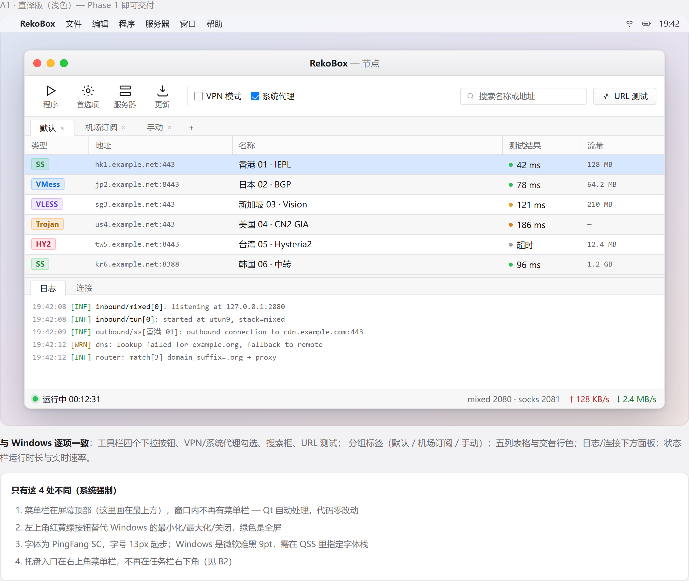
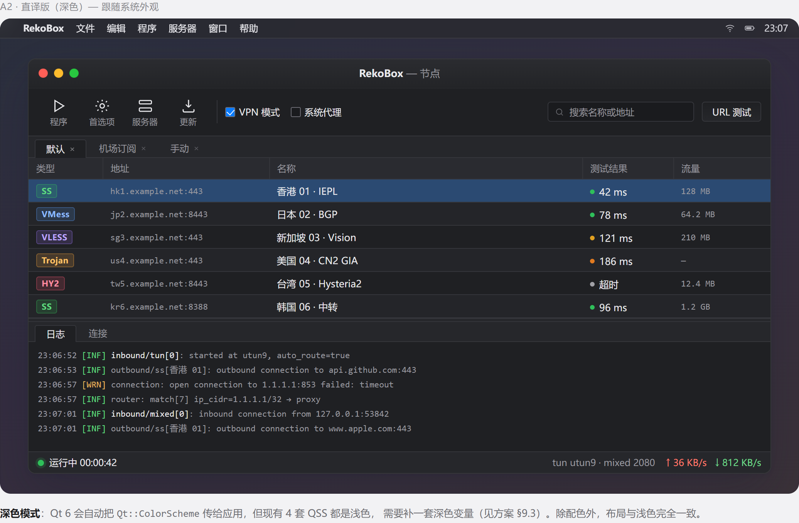
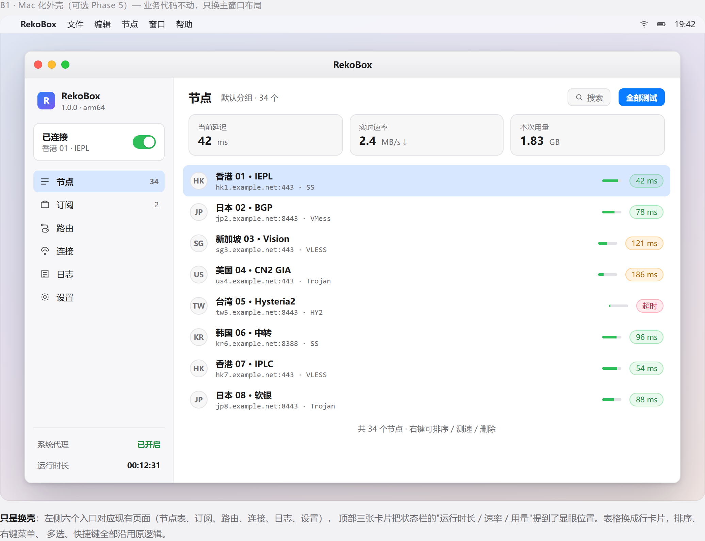
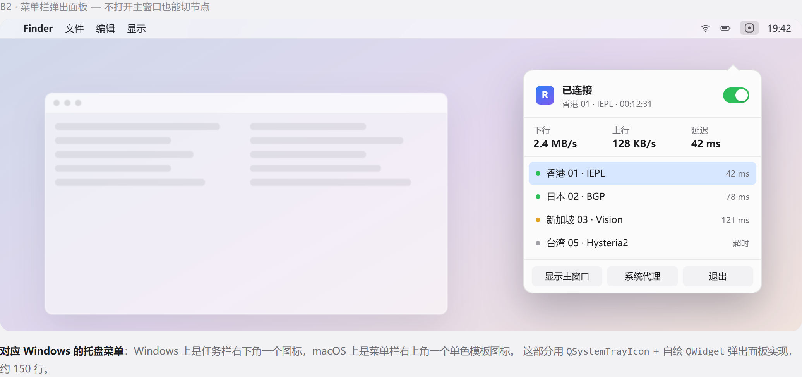
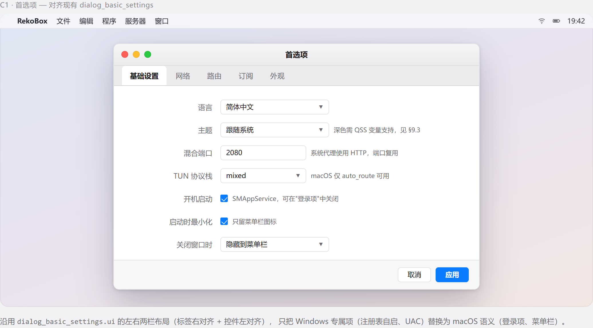

# 06 · Rekobox for macOS 移植方案（Apple Silicon / M2）

> 目标机器：MacBook Air M2（8 GB / 256 GB，macOS 14+）。
> 目标产物：`RekoBox.app`（arm64）+ `.dmg`，与 Windows 版同界面、同内核、同账号体系。
> 关联文档：[`02-windows-port.md`](02-windows-port.md)（架构差异）、[`04-account-sync.md`](04-account-sync.md)（节点池）。
>
> **进度（2026-11-20）**：P0/P1 骨架已落地（CMake APPLE 分支、`sys/macos/`、mac TUN 脚本、
> 一键构建脚本），**但还没在 Mac 上编译过**。下一步与逐条待办见
> [`../RekoboxForMac/docs/HANDOFF.md`](../RekoboxForMac/docs/HANDOFF.md)。

---

## 0. 先回答两个问题

### 0.1 界面能和 Windows 一样吗？

**能，而且不用重写。** Windows 版是 Qt 6.7 Widgets，`ui/*.ui` + `res/neko.css` 本身跨平台，
同一套源码在 macOS 上编译出来就是同一套界面：同样的工具栏、同样的分组标签、同样的
`类型 / 地址 / 名称 / 测试结果 / 流量` 表格、同样的日志与连接面板、同样的状态栏。

差别只有 6 处，且都是操作系统强加的：

| # | 差异 | 说明 | 能否消除 |
|---|---|---|---|
| 1 | 菜单栏跑到屏幕顶部 | Qt 在 macOS 上自动把 `QMenuBar` 变成全局菜单栏 | 不能（系统规范） |
| 2 | 标题栏变红绿灯 | 原生窗口装饰，无最大化按钮（绿色是全屏） | 不能（除非自绘无边框窗口） |
| 3 | 托盘变成菜单栏状态项 | `QSystemTrayIcon` = 右上角图标，需要单色模板图 | 位置上不能，交互可做 |
| 4 | 字体不同 | PingFang SC / SF Pro vs 微软雅黑 | 可以用 QSS 指定字体，但会显得不 native |
| 5 | 原生控件外观 | 默认 macOS style 的按钮/下拉比 Windows 矮、圆角大 | 能：`-style fusion` 强制回 Fusion 观感 |
| 6 | 细节 | 滚动条悬浮、焦点环、Cmd 代替 Ctrl、原生文件对话框 | 部分可关 |

结论：**内容与排版 100% 一致，像素级约 95%**。真要做到 100% 只能在 Mac 上自绘整个窗口
（无边框 + 自绘标题栏 + 屏内菜单栏），代价大、体验反而更差，不建议。

如果要"一眼像 Mac 原生应用"，另有一条路：保留全部业务代码，只换外壳（侧边栏 + 状态卡 +
菜单栏弹出面板），见 §9 与 `RekoboxForMac/mockups/`。这条路是**皮肤级改造**，不是重写。

### 0.2 用 Android 那套界面行不行？

不行，性价比极低。Android 端是 `49 个 Fragment + 46 个 layout XML + 13 个自定义 View` 的
Material 实现，和 macOS 没有共享可能：

- 想复用它只能走 Compose Multiplatform，而 Android 端是 Fragment/View 体系，等于重写；
- Android 的界面是为触屏 + 单手设计的，放桌面端信息密度太低；
- 复用率：Android 路线 ≈ 0%，Windows Qt 路线 ≈ 90%。

**所以：以 `RekoboxForWindows/` 为母本移植，是唯一合理路线。**

---

## 1. 现状盘点

| 项 | 数值 | 说明 |
|---|---|---|
| 界面层 | 70 个文件 / 11.8k 行 | `mainwindow.cpp` 1891 行、9 个对话框、4 个自定义控件、895 行 `.ui` |
| 自有 C++ 总量 | 114 个文件 / ≈19k 行 | 不含 `3rdparty/`、`libs/`、内核 |
| 内核 | `rekobox_core` = sing-box 1.12.19-neko-1 | 与 Android 共用源码树，Go 1.25 构建 |
| 控制面 | 手写 gRPC over HTTP/2 + 本地 socket | 跨平台，macOS 无需改 |
| 已有 macOS 分支 | 5 处 | 见下表，说明上游 nekoray 早就预留了 mac 支持 |

已存在的 macOS 代码（**不用从零写**）：

| 位置 | 内容 | 状态 |
|---|---|---|
| `db/ConfigBuilder.cpp:26` | `genTunName()` 返回 `utun9` | 可用，但建议改为自动分配 |
| `sys/AutoRun.cpp` | `LSSharedFileList` 写登录项 | 可用但 API 已废弃，建议换 `SMAppService` |
| `ui/mainwindow.cpp:1849/1872` | `osascript ... with administrator privileges` 提权跑 TUN | 可用 |
| `3rdparty/qv2ray/.../QvProxyConfigurator.cpp` | `networksetup -setwebproxy` 设系统代理 | 可用 |
| `main/main.cpp` | `NKR_CPP_USE_APPDATA` 宏（注释写着 "Package & MacOS"） | 需补 appdata 路径 |

缺失的部分集中在：**CMake 的 APPLE 分支、`sys/macos/` 平台层、bundle 打包签名、TUN 脚本**。

---

## 2. 目标与非目标

**做**

1. 原生 arm64 的 `RekoBox.app`，启动即用，不依赖用户装 Qt/Go。
2. 系统代理（无需密码）与 TUN（需授权）两种模式都能工作。
3. 账号登录 + 节点池拉取、分组、路由、日志、连接表全功能对齐 Windows。
4. 菜单栏常驻、登录启动、单实例、退出还原代理。
5. 可分发：签名 + 公证的 `.dmg`（或明确标注"未签名，需右键打开"）。

**不做（第一期）**

- Mac App Store 上架（要 NetworkExtension + 沙盒，架构级重写）。
- 分应用代理（macOS 无 UID 白名单；用路由规则 `process_name` 代替，与 Windows 一致）。
- Intel Mac 支持（先 arm64；universal 留给 M5）。
- 与 Windows 共享安装包 / 自动更新通道（各自独立发版，tag 前缀 `mac-vX.Y.Z`）。

---

## 3. 目标架构

```
RekoBox.app/Contents/MacOS/
├── rekobox                 Qt GUI（用户态，普通权限）
├── rekobox_core            sing-box 1.12.19-neko-1（TUN 模式下以 root 运行）
├── qt.conf / Qt6*.framework
└── ../Resources/           icns、translations、分流数据
        │
        │  gRPC over unix socket（系统代理模式）
        │  gRPC over 127.0.0.1:随机端口 + token（TUN 模式，避开 root/用户权限问题）
        ▼
   sing-box 内核 ──► mixed 入站 2080/2081（系统代理）
                └─► tun 入站 utunN（TUN 模式，auto_route）
```

| 关注点 | Windows 现状 | macOS 方案 |
|---|---|---|
| 内核装载 | `rekobox_core.exe` 子进程 | 同名 arm64 二进制，`QProcess` 启动 |
| 隧道 | Wintun + `tun` 入站 | `utun`（系统自带）+ `tun` 入站，`auto_route: true` |
| 提权 | UAC（`WinCommander`） | `osascript` 管理员授权（MVP）→ `SMAppService` 特权助手（P4） |
| 控制面 | 本地 socket gRPC | 同左（TUN 模式改 TCP 回环） |
| 系统代理 | WinINet 注册表 | `networksetup -setwebproxy/-setsocksfirewallproxy` |
| 开机启动 | `HKCU\...\Run` | `SMAppService.mainAppService`（macOS 13+） |
| 常驻 | 托盘 | 菜单栏状态项（`QSystemTrayIcon` + 模板图） |
| 崩溃捕获 | `MiniDump`（dbghelp） | `qInstallMessageHandler` + `backtrace()`，落 `~/Library/Logs/Rekobox` |
| 数据目录 | `%LOCALAPPDATA%\Rekobox` | `~/Library/Application Support/Rekobox` |

### 3.1 代码组织：一棵树（已落地），改名留到最后

**决定：共享一棵树，目录暂时还叫 `RekoboxForWindows/`。**

理由是"共享"的实质是**同一份源码同时给两个平台构建**，而不是目录叫什么。现在改名会同时
打断 CI、文档里 15 处链接和发布脚本，而收益只是名字好看；等 mac 端能编过、发过第一个
内部版本之后再改，成本就是一条命令。

已经落地的东西（本次提交）：

| 内容 | 位置 |
|---|---|
| 平台选择 | `CMakeLists.txt`：`if(WIN32) … elseif(APPLE) … else()` |
| mac 平台变量 | `cmake/macos/macos.cmake`（`PLATFORM_SOURCES` / `PLATFORM_LIBRARIES` / NKR_CPP_USE_APPDATA） |
| bundle 元数据 | `CMakeLists.txt` 里 target 创建后的 `if(APPLE)` 块 + `cmake/macos/Info.plist.in` |
| 平台实现 | `sys/macos/MacPlatform.{hpp,cpp}`（数据目录、Fusion 外观、shell/AppleScript 转义） |
| 构建入口 | `libs/build_macos.sh`、`libs/make_icns.sh` |

Windows 侧不受影响：`WIN32` 分支、`windows.cmake`、`.rc` 资源都没动。

> 以后真要改名，执行：
> `git tag desktop-shared-base && git mv RekoboxForWindows RekoboxForDesktop`，
> 再全局替换 `RekoboxForWindows` → `RekoboxForDesktop`（README、docs/02、docs/04、docs/05、
> RekoboxForMac/README、`.github/workflows/*`），最后在旧路径留一个指路 README。

---

## 4. P0 · 环境（0.5 天）

M2 上需要的东西，全部走 Homebrew + aqtinstall，无需 Xcode 完整版（Command Line Tools 够）：

```bash
xcode-select --install                     # CLT：clang、codesign、iconutil、notarytool 之外的都在
brew install cmake ninja go
# 三个 C++ 依赖不从 brew 装：版本要和 Windows 对齐（protobuf 21.4 / yaml 0.7.0 / zxing 2.0.0）
# 用 bash libs/build_deps_macos.sh 从源码编到 libs/deps/built，见 §5.0

# Qt 6.7.2（与 Windows 同版本，保证 QSS/控件行为一致；官方 mac 包是 universal）
python3 -m pip install aqtinstall
python3 -m aqt install-qt mac desktop 6.7.2 clang_64 -O ~/Qt \
        --archives qtbase qtsvg qttools
```

验证：

```bash
~/Qt/6.7.2/macos/bin/qmake -v          # 应显示 Using macOS 版本 / arm64
go version                             # go1.2x darwin/arm64
cmake --version && ninja --version
```

**protobuf / yaml-cpp / zxing-cpp 不要盲目用 brew 最新版**：Windows 端锁定的是
protobuf 21.4 / yaml-cpp 0.7.0 / zxing-cpp 2.0.0，`rpc/` 的手写 gRPC 与 `myproto.cmake`
生成代码对 protobuf 大版本敏感。建议照 `libs/build_deps_mingw.sh` 写一份
`libs/build_deps_macos.sh` 从源码编这三个依赖（约 10 分钟），版本与 Windows 对齐。

---

## 5. P1 · 编译出第一个窗口（1–2 天）

### 5.1 CMake：加 APPLE 分支

`CMakeLists.txt` 现在是 `if (WIN32) windows.cmake else() linux.cmake`，macOS 会掉进 Linux 分支
（链 `dl`、编 `LinuxCap.cpp`，必然失败）。改成三段：

```cmake
if (WIN32)
    include("cmake/windows/windows.cmake")
elseif (APPLE)
    include("cmake/macos/macos.cmake")
else ()
    include("cmake/linux/linux.cmake")
endif ()
```

新增 `cmake/macos/macos.cmake`（**已落地**，只产出变量，不碰 target）：

```cmake
set(PLATFORM_SOURCES sys/macos/MacPlatform.cpp)
set(PLATFORM_LIBRARIES
        "-framework AppKit"
        "-framework CoreFoundation"
        "-framework CoreServices"
        "-framework Carbon")          # QHotkey 需要
add_definitions(-DNKR_CPP_USE_APPDATA)
```

bundle 属性必须放在 **target 创建之后**（`cmake/nkr.cmake` 的 include 早于
`qt_add_executable`，在平台文件里设 target 属性会报 "target not found"），所以写在
`CMakeLists.txt` 的 `set_target_properties(rekobox ... WIN32_EXECUTABLE TRUE)` 后面：

```cmake
if (APPLE)
    set_target_properties(rekobox PROPERTIES
            OUTPUT_NAME "RekoBox"
            MACOSX_BUNDLE TRUE
            MACOSX_BUNDLE_BUNDLE_NAME "RekoBox"
            MACOSX_BUNDLE_GUI_IDENTIFIER "io.rekobox.mac"
            MACOSX_BUNDLE_ICON_FILE "rekobox.icns"
            MACOSX_BUNDLE_BUNDLE_VERSION "${NKR_RC_VERSION}"
            MACOSX_BUNDLE_SHORT_VERSION_STRING "${NKR_RC_VERSION}"
            MACOSX_BUNDLE_INFO_PLIST "${CMAKE_CURRENT_SOURCE_DIR}/cmake/macos/Info.plist.in")
endif ()
```

同时要处理的编译期问题（按出现顺序）：

| 现象 | 处理 |
|---|---|
| `3rdparty/WinCommander.cpp` 编译失败 | 只在 `WIN32` 下加入源码（`windows.cmake` 已如此，确认 mac 不引） |
| `rasapi32 / wininet` 头找不到 | 同上，已隔离在 `Q_OS_WIN` |
| `-ldl` 未定义 | mac 无 librt/dl，`PLATFORM_LIBRARIES` 不要写 `dl` |
| `MiniDump.cpp` 用 dbghelp | macOS 不编这个文件（`platform` 源里只有 `sys/macos/MacPlatform.cpp`）；崩溃捕获 P4 补 `backtrace()` |
| `QHotkey` 链接失败 | 加 `-framework Carbon` |
| `LSSharedFileList` 警告 | 可用（已废弃），P4 换 `SMAppService` |

### 5.2 Info.plist 要点

```xml
<key>CFBundleIdentifier</key><string>io.rekobox.mac</string>
<key>LSMinimumSystemVersion</key><string>13.0</string>   <!-- 用 SMAppService 的话必须 13+ -->
<key>NSHighResolutionCapable</key><true/>
<key>LSUIElement</key><false/>                 <!-- true 则纯菜单栏应用，无 Dock 图标 -->
<key>NSHumanReadableCopyright</key><string>GPL-3.0</string>
```

`LSUIElement` 建议先 `false`（有 Dock 图标，像普通应用），把"仅菜单栏模式"作为设置项
（运行时 `NSApp.setActivationPolicy(.accessory)`）。

### 5.3 数据目录

`main.cpp` 在 `NKR_CPP_USE_APPDATA` 下用 `QStandardPaths::AppConfigLocation` 兜底，
macOS 上这个值是 `~/Library/Preferences/<app>`——放配置数据是错的。改成：

```cpp
#ifdef Q_OS_MACOS
    wd.setPath(QStandardPaths::writableLocation(QStandardPaths::AppDataLocation));
    // ~/Library/Application Support/rekobox
#endif
```

**必须走 appdata**：bundle 内是只读的，`QDir::setCurrent(applicationDirPath())` 之后
`mkpath("profiles")` 会失败。

### 5.4 图标与菜单栏

- `res/rekobox.ico` → `rekobox.icns`：`mkdir icon.iconset && sips -z 16 16 ...` 生成 10 个尺寸后
  `iconutil -c icns`。写进 `libs/make_icns.sh` 便于重生成。
- 工具栏图标：Windows 依赖 `QIcon::setThemeName("breeze")` + `:/icon` 兜底，macOS 无系统图标主题，
  `setFallbackSearchPaths({":/neko", ":/icon"})` 已在 `main.cpp` 里，**大概率能直接显示**，
  但要在深色模式下检查 SVG 是否写死黑色描边（必要时用 `currentColor` 或双套图）。
- 菜单栏状态图标要做**模板图**（`QIcon::setIsMask(true)` + 纯黑透明 PNG），否则深色菜单栏下看不见。
- 首次 `QSystemTrayIcon` 出现在菜单栏后，macOS 会记住位置，别频繁重建。

### 5.5 验收（M1）

```bash
bash RekoboxForWindows/libs/build_macos.sh      # 图标 → 内核 → configure → 编译 → 部署 → ad-hoc 签名
open RekoboxForMac/build/RekoBox.app
```

- 窗口出现，界面元素与 Windows 截图逐项一致（工具栏 4 个按钮 / 分组标签 / 5 列表格 / 日志区 / 状态栏）；
- 菜单栏在屏幕顶部，含 程序 / 首选项 / 服务器；
- 关窗后进程不退出（`setQuitOnLastWindowClosed(false)`），菜单栏图标可唤回；
- 配置文件落在 `~/Library/Application Support/rekobox/`。

---

## 6. P2 · 打通代理闭环（3–4 天）

### 6.1 内核二进制

```bash
# 前置：仓库根有 sing-box 源码树，且 overlay 过 neko 包
bash libs/get_source_local.sh && bash libs/apply_neko_patch.sh

cd go/cmd/rekobox_core
CGO_ENABLED=0 GOOS=darwin GOARCH=arm64 go build -trimpath \
  -ldflags "-w -s -X github.com/matsuridayo/libneko/neko_common.Version_neko=1.0.15" \
  -tags "with_clash_api,with_v2ray_api,with_gvisor,with_quic,with_wireguard,with_utls" \
  -o ../../../RekoboxForMac/build/core/rekobox_core .
```

内核入口是 `go/cmd/rekobox_core`（import libneko + `sing-box/neko`），**不是**从 sing-box
树里直接 build `./neko`——那条路只产出库，没有 `main`。`build_macos.sh` 已封装这一步。

- 与 Windows 共用同一份 `neko/` 包（`libs/apply_neko_patch.sh` 产出的那套）；版本号由
  `-X ...Version_neko=` 注入，和 Windows 端同源。
- 二进制**必须签名**（哪怕 ad-hoc），否则公证后的 App 从 bundle 里 exec 会被 Gatekeeper 拦。
- 交叉编译注意：如果内核里用了 `cgo` 的库（本项目这套 tags 下没有），`CGO_ENABLED=0` 才能在
  非 mac 机器上编；在 M2 本机编更省事。

### 6.2 系统代理（不需要密码，优先跑通）

`QvProxyConfigurator` 里 `networksetup` 分支已存在，但要补三件事：

1. **记录改了哪些服务**：`networksetup -listallnetworkservices` 里除 `*` 禁用项外全部设置；
   把服务名列表落盘，退出/崩溃恢复时按列表还原（否则插拔网卡后残留代理会断网）。
2. **bypass 列表**：`networksetup -setproxybypassdomains <service> localhost 127.0.0.1 *.local 192.168.*`。
3. **还原要幂等**：`-setwebproxystate off` / `-setsecurewebproxystate off` /
   `-setsocksfirewallproxystate off`，三个都要关。

验证：

```bash
networksetup -getwebproxy Wi-Fi        # 应显示 Enabled: Yes / Server: 127.0.0.1 / Port: 2080
curl -x http://127.0.0.1:2080 https://ip.sb
```

### 6.3 TUN（需要 root）

macOS 上 sing-box 必须 root 才能建 `utun` 并改路由表。现有 `vpn-run-root.sh` 是 Linux 版
（`iptables`），macOS 要单独一份 `res/vpn/vpn-run-root-macos.sh`：

```bash
#!/bin/sh
# 仅 macOS；sing-box 自己建 utun 与路由，不需要 iptables
cd "$(dirname "$0")"
exec ./rekobox_core --disable-color run -c "$CONFIG_PATH"
```

配套改动：

| 项 | 改法 |
|---|---|
| `interface_name` | 置空，让内核自动挑 `utunN`（写死 `utun9` 会和 Tailscale/WireGuard 撞） |
| `strict_route` | macOS 无实现，强制 `false` |
| `auto_redirect` | Linux 专有，不设 |
| `route.auto_detect_interface` | 必须 `true`（缺了会报 `missing default network interface`，见 §11） |
| DNS | `fakeip` + `dns-remote` 走 socks，逻辑与 Windows 一致 |
| 提权 | `osascript -e 'do shell script "bash ..." with administrator privileges'`（已有分支） |

**关于 root 与进程间通信（已核对代码，和预想不同）**：

- 控制面不是 unix socket：主内核用 `-port <随机端口>` + `core_token` 走 TCP 回环
  （`ui/mainwindow.cpp` 的 `MkPort()`、`setup_grpc()`），本来就跨平台，**没有 socket 权限问题**。
- TUN 内核是一个**独立的一次性进程**：`WriteVPNSingBoxConfig()` 生成的配置里没有
  `experimental.clash_api`，它只做 `tun` 入站 + 本地 socks 出站，不提供 gRPC。
  所以 root 权限只影响"能不能建 utun 和改路由"，不影响 GUI 通信。
- 真正要注意的是**文件写入**：现在 tun 内核只读配置、日志走 stderr 由 GUI 收，不写盘，所以 P2
  可以直接用。一旦以后打开 `cache_file` 或落盘日志，root 写出来的文件属主就是 root，
  用户态下次启动会读不了——那时再把路径指到 `/tmp/rekobox-<uid>/` 或启动后 `chown`。
- `osascript` 每次启动 TUN 会弹一次授权框（P4 换 `SMAppService` 助手解决）；路径里有空格时
  原来的拼串会坏，已在 `mainwindow.cpp` 做 shell + AppleScript 两层转义。

验证：

```bash
netstat -rn | grep utun            # 应有 utunN 且 default 指向它
scutil --dns | head -20            # DNS 应被接管
curl https://ip.sb                 # 不带 -x，出口 IP 应变化
```

### 6.4 其余平台件

| 功能 | 做法 |
|---|---|
| 单实例 | `RunGuard`（QSharedMemory）在 mac 可用；更稳的是 `QLocalServer` + `flock` 锁文件 |
| 菜单栏常驻 | `QSystemTrayIcon` + 模板图；点击弹菜单（节点切换 / 系统代理 / 显示窗口 / 退出） |
| 登录启动 | `SMAppService.mainAppService.register()`，需要 macOS 13+，写进"系统设置 → 通用 → 登录项" |
| Cmd 快捷键 | 全局搜索 `QKeySequence("Ctrl+...")`，改 `QKeySequence::StandardKey` 或 `QKeySequence(Qt::CTRL | ...)` 让 Qt 自动映射成 Cmd |
| Cmd+Q / Cmd+W | `Cmd+W` 隐藏窗口不退出，`Cmd+Q` 才退出；退出前 `stop core` + `clear proxy` |
| App Nap | 后台被节流会让流量统计停滞：`ProcessInfo.beginActivity(.userInitiatedAllowingIdleSystemSleep)` |
| 崩溃 | `qInstallMessageHandler` 写 `~/Library/Logs/Rekobox/crash-<ts>.log` |

### 6.5 验收（M2）

- [ ] 粘贴 `ss://` / `vmess://` 链接 → 导入 → 启动 → `curl -x` 出口 IP 变化
- [ ] 勾选"系统代理" → 浏览器能上外网；取消 → 立即恢复
- [ ] 强杀 App（`kill -9`）后重新打开 → 自动清理残留代理，网络正常
- [ ] TUN 模式：授权弹窗 → 建 `utun` → `curl https://ip.sb` 直连也走代理
- [ ] 停 TUN → 路由表恢复，无残留 default 路由
- [ ] 关闭窗口 → 菜单栏图标仍在；点图标能唤回
- [ ] 登录启动开关生效，重启后自动起在菜单栏
- [ ] 双开被拦截（`-many` 可强制）

---

## 7. P3 · 打包、签名、公证（1–2 天）

```bash
# 1. 部署 Qt 运行时
~/Qt/6.7.2/macos/bin/macdeployqt build/RekoBox.app -always-overwrite

# 2. 签名（先内后外：内核 → framework → app；framework 已由 macdeployqt 处理，最后整体签）
codesign --force --options runtime --timestamp \
         --sign "Developer ID Application: <NAME> (<TEAMID>)" build/RekoBox.app/Contents/MacOS/rekobox_core
codesign --force --options runtime --timestamp \
         --sign "Developer ID Application: <NAME> (<TEAMID>)" build/RekoBox.app

# 3. 打 dmg + 公证
hdiutil create -volname "RekoBox" -srcfolder build/RekoBox.app -ov -format UDZO dist/RekoBox-1.0.0-mac-arm64.dmg
xcrun notarytool submit dist/RekoBox-1.0.0-mac-arm64.dmg --keychain-profile AC --wait
xcrun stapler staple dist/RekoBox-1.0.0-mac-arm64.dmg
spctl -a -vvv -t install dist/RekoBox-1.0.0-mac-arm64.dmg   # 应显示 accepted / Notarized Developer ID
```

| 情况 | 用户侧体验 |
|---|---|
| 有 Developer ID（$99/年）+ 公证 | 双击直接打开，无任何提示 |
| 仅 ad-hoc 签名（`codesign -s -`） | 首次需右键 → 打开，或 `xattr -dr com.apple.quarantine RekoBox.app` |
| 完全不签名 | Apple Silicon 上**直接报"已损坏"**，无法启动（arm64 强制要求至少 ad-hoc 签名） |

即便走 ad-hoc，也务必签名 + 在 README 写清"右键打开"，否则下载量会变成报障量。

CI：`.github/workflows/` 加 `macos-14` job（arm64 runner），矩阵
`{cmake build, go build darwin/arm64, macdeployqt, ad-hoc sign, upload artifact}`。
带公证的正式发布那一步放本地或加 secrets，不在 PR 里跑。

---

## 8. P4 · 体验补齐（3–5 天，可与 P5 并行）

1. **特权助手**（替代每次输密码）
   `SMAppService.daemon` + 一个最小 LaunchDaemon：GUI 通过 XPC 让助手以 root 启停内核，
   只在首次安装时授权一次。需要 Developer ID 签名（ad-hoc 不行），所以排在公证之后。
   在此之前，"每次启动 TUN 输一次密码"是可接受的 MVP 行为，要在 UI 上说明。
2. **自动更新**：Sparkle 2（`appcast.xml` + EdDSA 签名）比自研稳；也可沿用 Windows 的
   GitHub Releases 检查 + 下载 dmg + `open` 提示用户拖入 Applications。
3. **登录项迁移**：`LSSharedFileList` → `SMAppService`，顺带支持"启动时静默进菜单栏"。
4. **深色模式**：Qt 6 会自动跟随系统 `colorScheme`，但现有 4 套 QSS 都是浅色。
   见 §9.3。
5. **崩溃上报 / 日志归档 / 一键导出诊断包**（对齐 Windows 的排错流程）。

---

## 9. 界面：两条路

`RekoboxForMac/mockups/index.html` 里有 5 张效果图，A 组是"和 Windows 一样"，B 组是"更像 Mac"。

### 9.1 方案 A：直译（P1 就能有，推荐先上）

同一套 `.ui` + `neko.css`，只做 4 处适配：

1. 启动参数加 `-style fusion`（或 `QApplication::setStyle("Fusion")`），否则 macOS style 会把
   按钮压到 22px 高、下拉框换成原生外观，和 Windows 观感差一截。
2. QSS 里补字体栈：`font-family: -apple-system, "PingFang SC", "Helvetica Neue", sans-serif;`
   字号从 9pt 提到 13px（mac 的 13px ≈ win 的 9pt 视觉大小）。
3. 表格行高 30 → 28，表头加 `alternate-background-color`，滚动条改 overlay 宽度 8px。
4. 去掉 `Qt::AA_DontUseNativeDialogs`（`main.cpp` 里全局设了），让"导入文件"用原生面板。

结果：**看上去就是 Windows 版换了个系统壳**，成本 0.5 天。

### 9.2 方案 B：Mac 化外壳（P5，4–6 天，可选）

业务逻辑不动，只换主窗口布局：

| 改动 | 内容 |
|---|---|
| 左侧边栏 | 节点 / 订阅 / 路由 / 连接 / 日志 / 设置，220px，`QListWidget` + 自绘选中态 |
| 顶部状态卡 | 当前节点、连接时长、上/下行、延迟，一个"大开关"控制启停 |
| 节点列表 | 由 5 列表格改为"名称 + 地区徽标 + 延迟胶囊 + 流量"的行卡片，保留排序与右键菜单 |
| 菜单栏弹出面板 | 点状态项弹 320px 面板：开关 / 当前节点 / 快速切换 / 流量，不打开主窗口也能用 |
| 毛玻璃 | 侧边栏用 `NSVisualEffectView`（`QWidget::winId()` 桥接），或退一步用半透明纯色 |
| 深色模式 | 两套 QSS 变量（`--bg / --panel / --line / --text / --sub / --accent`），监听 `colorSchemeChanged` |

方案 B 的风险是**双份布局代码**（`mainwindow.ui` 与 mac 版并存）。做法：把界面拆成
`ui/pages/*` 独立 `QWidget`，mac 外壳只负责导航与容器，Windows 外壳继续用旧布局。
这样两种外壳共用页面，不会分叉。

### 9.3 深色模式的最小实现

```cpp
// 主题切换：跟随系统 / 浅色 / 深色
connect(qApp->styleHints(), &QStyleHints::colorSchemeChanged, this, [=](Qt::ColorScheme s) {
    if (dataStore->theme == 0) ApplyTheme(s == Qt::ColorScheme::Dark ? "mac-dark" : "mac-light");
});
```

QSS 用 `@变量` 预处理（构建时用一个小脚本替换），避免维护两份完整 CSS。

---

## 10. 平台层替换清单（施工单）

| Windows 实现 | 文件 | macOS 替代 | 新增文件 |
|---|---|---|---|
| `WinCommander::runProcessElevated`（UAC） | `3rdparty/WinCommander.cpp` | `osascript` 管理员（MVP）/ XPC 助手（P4） | `sys/macos/Elevate.mm` |
| WinINet 系统代理 | `3rdparty/qv2ray/.../QvProxyConfigurator.cpp` | `networksetup`（已有分支，补还原与 bypass） | 改动现有 |
| `HKCU\...\Run` | `sys/AutoRun.cpp` | `SMAppService.mainAppService` | 改动现有 |
| `MiniDump`（dbghelp） | `sys/windows/MiniDump.cpp` | `backtrace()` + 日志文件 | `sys/macos/Crash.mm` |
| `guihelper.cpp`（置前/闪烁） | `sys/windows/guihelper.cpp` | `[NSApp activateIgnoringOtherApps:YES]` | `sys/macos/Gui.mm` |
| Wintun / `wintun.dll` | `libs/deploy_windows_mingw.sh` | 系统 `utun`，无需随包 | — |
| `vpn-run-root.sh`（iptables） | `res/vpn/` | `vpn-run-root-macos.sh`（无 iptables） | 新增 |
| 防火墙提示 | 文档 | 首次入站弹"允许接受传入连接" | 文档 |
| `windeployqt` | `libs/deploy_windows_mingw.sh` | `macdeployqt` | `libs/deploy_macos.sh` |
| 图文资源 `.ico` | `res/rekobox.ico` | `rekobox.icns` + 模板状态图 | `libs/make_icns.sh` |

---

## 11. 风险与坑（按发生概率排序）

| # | 风险 | 现象 | 对策 |
|---|---|---|---|
| 1 | root 内核写盘 | 以后开 `cache_file`/落盘日志时，属主变 root，用户态读不了 | 现在不写盘，无影响；要写就落到 `/tmp/rekobox-<uid>/` |
| 2 | `osascript` 路径带空格 | 命令拼坏，TUN 启动失败报语法错 | 已做 shell 单引号 + AppleScript 转义（`MacPlatform::ShellQuote/AppleScriptString`） |
| 3 | `utun9` 被占用 | 启动失败或流量不走代理 | `interface_name` 留空自动分配 |
| 4 | `auto_route` 未生效 | TUN 起来了但流量不进去（v2ex 上有同类反馈） | 必须 `route.auto_detect_interface: true`；用 `netstat -rn` + `curl` 双验证 |
| 5 | `strict_route` 不支持 | 配了没效果 | mac 上强制 false，UI 里隐藏该选项 |
| 6 | 系统代理残留 | 强杀后断网 | 落盘服务清单，启动时自愈；退出钩子里还原 |
| 7 | `networksetup` 权限 | 新版系统可能要求管理员 | 失败时降级提示"用 TUN 模式"；必要时走助手 |
| 8 | App Nap 节流 | 后台流量统计停跳、定时拉取延迟 | `beginActivity` 保持前台优先级 |
| 9 | 依赖版本漂移 | protobuf/zxing 编译或运行时报错 | 锁定 21.4 / 0.7.0 / 2.0.0，写进 `build_deps_macos.sh` |
| 10 | 未公证 | "已损坏，无法打开" | 至少 ad-hoc 签名 + README 写右键打开 |
| 11 | 图标在深色菜单栏消失 | 状态项看不见 | 模板图 + `setIsMask(true)` |
| 12 | `LSSharedFileList` 失效 | 登录启动不生效 | 换 `SMAppService`（macOS 13+） |
| 13 | Cmd 键位 | 快捷键按 Ctrl 注册无效 | 统一走 `QKeySequence::StandardKey` |
| 14 | 睡眠唤醒 | 唤醒后代理失效/内核僵死 | 监听 `NSWorkspaceDidWakeNotification`，必要时重启内核 |
| 15 | 8 GB 内存机器 | 编译 Qt 工程时 OOM | `ninja -j4`；内核构建单独跑 |

---

## 12. 验收清单（发布前）

```bash
# 功能
curl -x http://127.0.0.1:2080 https://ip.sb          # 系统代理模式
curl https://ip.sb                                   # TUN 模式
networksetup -getwebproxy Wi-Fi                      # 退出后应为 off
netstat -rn | grep -c utun                           # 停 TUN 后不应残留默认路由

# 稳定性
# 1) 睡眠 30 分钟唤醒 → 代理仍可用
# 2) 切换 Wi-Fi / 插拔 USB 网卡 → 系统代理跟随、不残留
# 3) kill -9 GUI → 重开自动清理
# 4) 连续启停 50 次，无泄漏（Activity Monitor 看内存与 fd）
# 5) 双显示器 + 全屏 + Retina 缩放，界面不错位

# 分发
spctl -a -vvv -t install dist/RekoBox-*.dmg
codesign -dv --verbose=4 build/RekoBox.app            # 应显示 Developer ID + hardened runtime
```

---

## 13. 工作量与里程碑

| 阶段 | 内容 | 人日 | 产出 |
|---|---|---|---|
| P0 | 环境、依赖、Qt | 0.5 | `flutter doctor` 式的自检脚本 |
| P1 | CMake APPLE 分支、第一个窗口（M1） | 1–2 | 能开、界面一致、数据目录正确 |
| P2 | 系统代理、TUN、托盘、单实例、登录启动（M2） | 3–4 | 可以日常用 |
| P3 | 打包、签名、公证、CI（M3） | 1–2 | 可分发 dmg |
| P4 | 特权助手、自动更新、深色、崩溃（M4） | 3–5 | 可对外发布 |
| P5 | Mac 化外壳（可选，M5） | 4–6 | 原生观感 |

**MVP（P0–P3）约 1–1.5 周单人工作量；到"能给别人用"约 3 周。**
其中真正不可压缩的是 P2 的 TUN 权限链路——那是 macOS 独有的坑，Windows 经验无法平移。

---

## 14. 附：界面效果图

可交互版：`RekoboxForMac/mockups/index.html`（浏览器打开）；同目录 PNG 可直接塞进文档/发布说明。

| 文件 | 内容 |
|---|---|
| `mock-A1-light.png` | 直译版 · 浅色 —— 与 Windows 逐项对照 |
| `mock-A2-dark.png` | 直译版 · 深色 |
| `mock-B1-sidebar.png` | Mac 化版 · 主窗口（侧边栏 + 状态卡） |
| `mock-B2-popover.png` | 菜单栏弹出面板 |
| `mock-C1-prefs.png` | 首选项窗口 |











> 效果图按现有 `mainwindow.ui` 的控件排布（工具栏 62px / 标签 28px / 表格行 30px / 状态栏 28px）、
> `neko.css` 的配色和真实文案重绘，用于对齐预期，不是最终截图。真实 Qt 渲染会有 1–2px 的字体度量差异。
